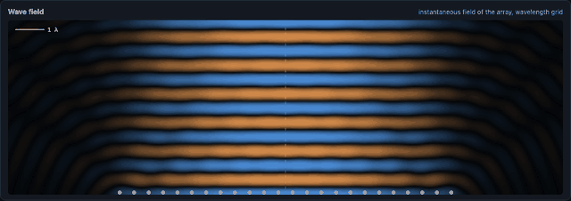
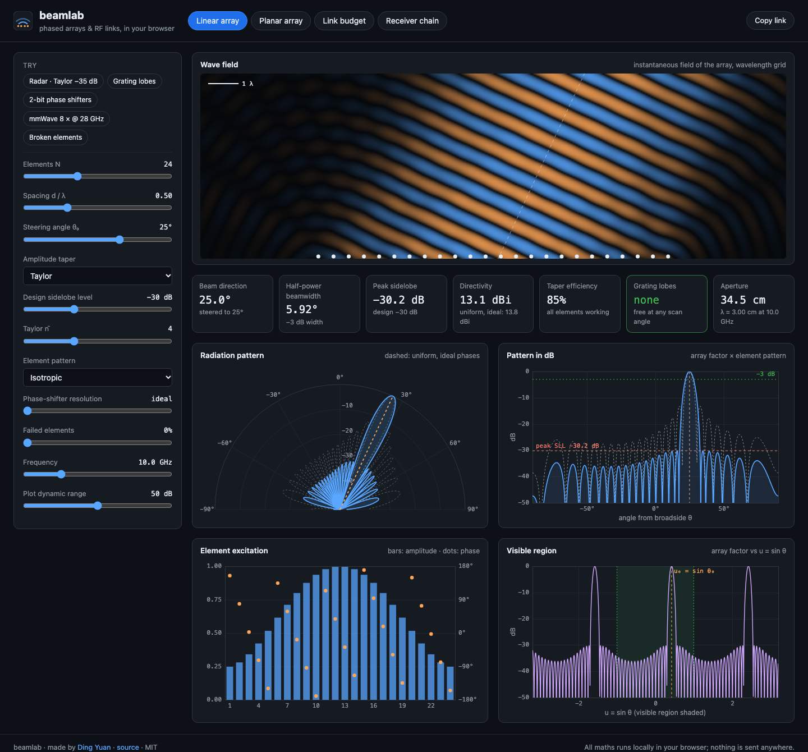
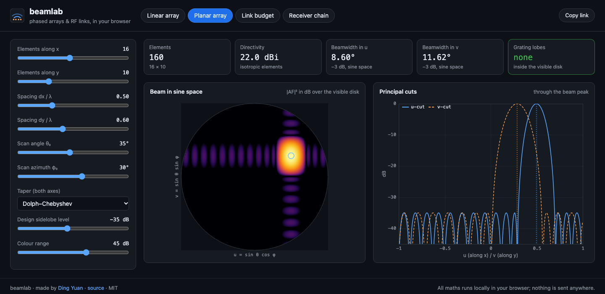
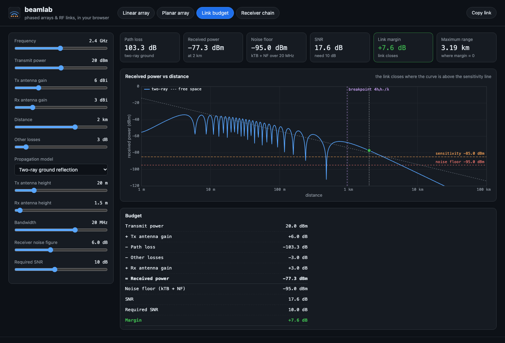
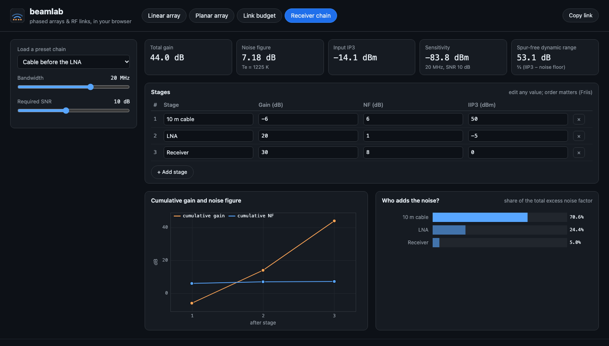

<h1 align="center">beamlab</h1>

<p align="center">
  <b>An interactive phased-array and RF link-budget lab that runs entirely in your browser.</b>
</p>

<p align="center">
  <a href="https://dy07077.github.io/beamlab/"><b>Open the live lab →</b></a>
</p>

<p align="center">
  <a href="https://github.com/Dy07077/beamlab/actions/workflows/ci.yml"></a>
  
  
  
</p>

<p align="center"></p>

Move a slider and every view updates live: the animated wave field in front of the array, the
radiation pattern, the element excitation and the beam metrics. There is no build step, no
framework and no dependency. It is plain JavaScript and `<canvas>`, about 2,000 lines including
styles and tests, and the maths is tested against closed-form results and SciPy.

## Four labs

<table>
<tr>
<td width="42%" valign="top">

**Linear array.** Set the element count, spacing and steering angle. Choose from seven amplitude
tapers, including Taylor and Dolph–Chebyshev, and three element patterns. Add phase-shifter
quantisation and failed elements. You get the live wave field, polar and dB patterns, the
excitation, and the visible region in u-space, plus beamwidth, peak sidelobe, directivity, taper
efficiency and grating-lobe warnings.

</td>
<td></td>
</tr>
<tr>
<td valign="top">

**Planar array.** Scan rectangular arrays in θ and φ. The tab shows the beam in sine space with
the visible disk, principal-plane cuts, directivity and beamwidths.

</td>
<td></td>
</tr>
<tr>
<td valign="top">

**Link budget.** Choose free space (Friis), two-ray ground reflection with its breakpoint, or a
log-distance model. Received power is plotted against distance alongside the noise floor and
sensitivity, with link margin and maximum range.

</td>
<td></td>
</tr>
<tr>
<td valign="top">

**Receiver chain.** Edit a chain of stages and see the Friis noise cascade, IIP3 cascade,
sensitivity, spur-free dynamic range, and each stage's share of the noise.

</td>
<td></td>
</tr>
</table>

## Things to try

- **Grating lobes.** Load the *Grating lobes* preset with d = λ, steered to 25°. A second, equally
  strong beam appears. In the *Visible region* plot you can watch its replica slide into the window.
- **Cheap phase shifters.** With 2-bit phase shifters and the beam steered to 8°, quantisation
  lobes rise to −8.8 dB. Three bits bring them back below the −13.2 dB sidelobes of the array itself.
- **Broken elements.** A −40 dB Dolph–Chebyshev array with 20% of its elements failed ends up with
  a −17.5 dB peak sidelobe. Low-sidelobe arrays are fragile.
- **Breakpoint.** On the two-ray model, drag the distance past 4hₜhᵣ/λ. Beyond it the loss falls
  at 40 dB/decade instead of 20.
- **Friis in one click.** Compare the *LNA at the antenna* and *Cable before the LNA* chains. They
  use the same three parts, but the noise figure goes from 1.76 dB to 7.18 dB.

Every control, including an edited receiver chain, is stored in the URL, so **Copy link** shares an
exact configuration.

## Verified maths

All maths lives in [`js/array.js`](js/array.js) and [`js/rf.js`](js/rf.js), which are pure
functions with no DOM. `node --test` checks them with the same functions and settings the page uses:

| Check | Reference |
| --- | --- |
| Uniform array: nulls at sin θ = k/Nd, HPBW → 0.886/Nd, first sidelobe −13.26 dB | closed form |
| Dolph–Chebyshev and Taylor weights | `scipy.signal.windows` to 10⁻⁷ |
| Chebyshev sidelobes all at the design level | within 0.05 dB |
| Linear-array directivity: the azimuth integral is done exactly, Simpson's rule in u | closed form within 0.01 dB, also for 64 elements at d = λ and 1.5λ |
| Element patterns in 3-D: a single λ/2 dipole, a single cosine element | 2.15 dBi and 10 log₁₀ 6; dipole arrays match a brute-force sphere integral |
| Planar-array directivity, in closed form | brute-force sphere integral within 0.01 dB |
| Cosine elements turn the fan beam into a pencil beam | +6.02 dB (10 log₁₀ 4) |
| Steering accuracy, grating-lobe positions (including endfire), quantisation lobes | analytic |
| Planar grating lobes: replicas of the beam that land inside the visible disk | brute-force search of the 2-D pattern |
| Share links keep an edited receiver chain | edit → share → reopen round trip, up to the editor's 24 stages and 40-character names |
| Free-space loss 100.05 dB at 2.4 GHz over 1 km; kTB = −174 dBm/Hz | standard values |
| Two-ray model tends to 40 log d − 20 log(hₜhᵣ) beyond the breakpoint | analytic |
| Friis noise and IIP3 cascades | hand-computed example |

## Run locally

```bash
git clone https://github.com/Dy07077/beamlab && cd beamlab
python3 -m http.server 8000      # then open http://localhost:8000
node --test test/*.test.mjs      # 33 tests; no npm install needed
```

The page uses ES modules, so open it over `http://`. Opening `index.html` straight from disk will
not work. Add `?t=0.5` to the URL to freeze the wave animation, which helps with screenshots.

## Layout

```text
index.html, css/style.css   the page
js/array.js                  tapers, steering, array factor, beam metrics, directivity
js/rf.js                     path-loss models, thermal noise, noise and IP3 cascades
js/share.js                  receiver chains in share links
js/plot.js                   canvas line, polar and heat-map plots (HiDPI aware)
js/app.js                    controls, URL state, wave-field animation
test/                        node:test suites for the maths
```

The four tabs follow a typical undergraduate antennas and RF-systems syllabus: arrays,
propagation and receiver design.

## References

1. C. A. Balanis, *Antenna Theory: Analysis and Design*, 4th ed., Wiley, 2016.
2. R. J. Mailloux, *Phased Array Antenna Handbook*, 3rd ed., Artech House, 2017.
3. C. L. Dolph, "A current distribution for broadside arrays which optimizes the relationship between beam width and side-lobe level," *Proc. IRE*, 1946.
4. T. T. Taylor, "Design of line-source antennas for narrow beamwidth and low side lobes," *IRE Trans. Antennas Propag.*, 1955.
5. D. M. Pozar, *Microwave and RF Design of Wireless Systems*, Wiley, 2001.
6. T. S. Rappaport, *Wireless Communications: Principles and Practice*, 2nd ed., Prentice Hall, 2002.

## License

MIT © 2026 Ding Yuan
